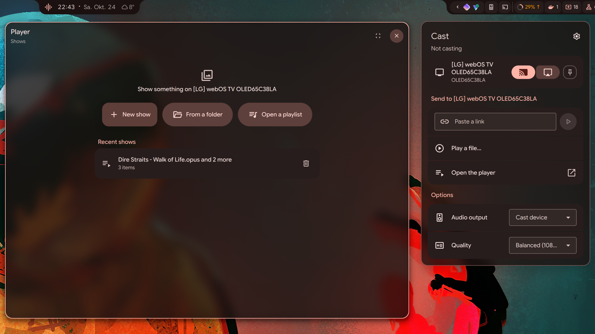
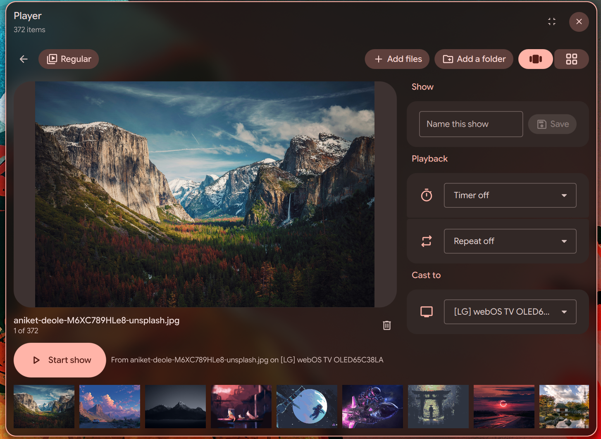
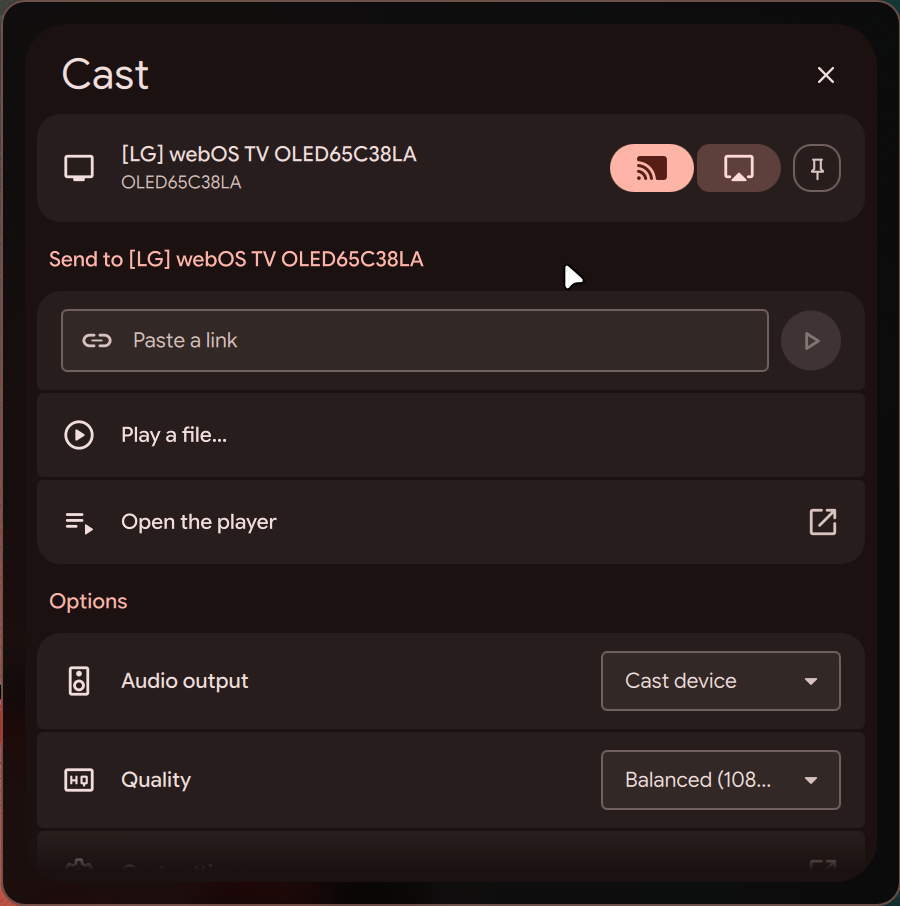
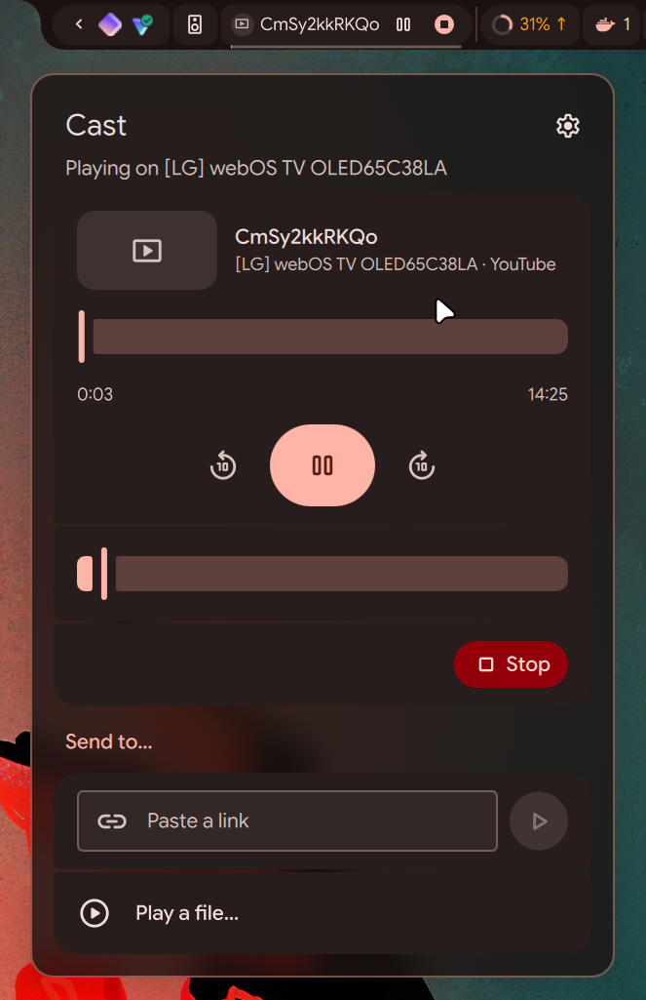

# Cast

Mirror your screen to Chromecast, Google TV and AirPlay devices, and play files, music, playlists, slideshows and media links on Chromecast.
Cast is controlled from the bar or the Control Center of [Dux Shell](https://github.com/duxlabs-dev/dux-shell).

> [!TIP]
> If you enjoy using Cast, please give it a thumbs up on its [registry issue](https://github.com/duxlabs-dev/dux-plugin-registry/issues/1089).
> The rating decides how visible the plugin is in the registry and helps others to find it.

[Features](#features) | [Installation](#installation) | [Reporting issues](#reporting-issues) | [Notes](#notes)

More screenshots

Create your own custom shows of images, videos or music: The player shows what the TV shows. The filmstrip below it contains the whole show and lets you control it.

The popout lists all available devices on the network.
For a TV with both Chromecast and AirPlay, the buttons next to the device select the protocol for mirroring, and the pin makes the device the default.

Put in a YouTube link and the plugin opens it in the YouTube app of the device and gives you full control over playback.

## Features

- Screen mirroring with sound, over Chromecast (up to 1080p60, encoded on the GPU) or AirPlay.
- Play sound on the cast device, on your computer, or on both.
- Videos, photos and music. Files that the device cannot play (e.g. 8K video, unsupported codecs or HEIC photos) are converted on the GPU in the background.
- A player for shows: mix files and folders, images, videos and music, save them as shows, play them on a timer or step through them manually. `.m3u` and `.pls` playlists are supported.
- YouTube links open in the YouTube app of the device and allow you to control playback.
- Direct media links play any media file from the internet.
- Controls in the bar pill, the Control Center and the media player widgets.

| Device | Mirroring | Files, music, links |
|---|---|---|
| Chromecast, Google TV, TVs with Chromecast built-in | Yes | Yes |
| Apple TV and TVs with AirPlay | Yes | Not yet |
| HomePod and other AirPlay speakers | No | Not yet |

Mirroring uses Chromecast unless AirPlay is selected for that device.
Files, music and links are not supported via AirPlay and only work on Chromecast devices.

## Installation

Cast requires a separate program [cast-helper](https://github.com/Conava/cast-helper) for the actual casting. The plugin itself only provides the GUI and the settings.
Other apps reuse the same helper.
Cast requires Dux Shell 2.0 or newer.

### 1. Install cast-helper

The Setup section in the settings of the plugin can do the installation of cast-helper and the required packages for you, as well as configure the firewall.
Alternatively, please consult the [installation guide of cast-helper](https://github.com/Conava/cast-helper#installation).

Linking plugin and helper

The plugin looks for the helper in these locations, in order of priority:
1. The Helper path setting in the plugin settings.
2. A development build from the `./dev` script of this repository, in `~/.local/share/dms/cast/dev/`.
3. `cast-helper` on `PATH`.
4. `~/.local/share/dms/cast/bin/`.

### 2. Install the plugin

Install the plugin from Settings > Plugins, or by hand as described in the [README of this repository](../README.md#installation) (folder `Cast`, id `cast`).
Enable the plugin and add it to a bar or the Control Center.

Until the helper, the required packages and the firewall are set up, the popout only links to the settings.
The Setup section in the settings lists the remaining steps, with buttons to install the packages or copy the command.
Commands that require root open in a terminal.

When a new helper version is available, the popout and the settings offer the update.
An older helper keeps working as long as it supports the protocol version that the plugin requires.

### 3. Open the firewall

The Setup section detects firewalld and ufw and can open the ports for them.
For any other firewall, open these ports by hand:

| Port | Description |
|---|---|
| TCP 47830 | Playing files (Chromecast only) |
| UDP 47840-47849 | Mirroring (AirPlay only) |
| UDP 5353 (mDNS) | Finding devices |

The ports can be changed in the settings.

## Device not found

A TV is only listed when it advertises Cast, so check that Chromecast built-in or Google Cast Receiver is enabled in the system apps of the TV.
Also ensure that both devices are on the same network, and that the firewall allows UDP 5353 (mDNS) for discovery.
Guest networks, VPNs and some routers may block discovery, so try to connect both devices to the same router without any of these in between.

## Reporting issues

Issues with the plugin UI, such as buttons, menus, settings or the setup, belong in the [issues of this repository](https://github.com/Conava/dux-plugins/issues/new/choose).
If the casting itself fails, for example with no image on the TV or a device that does not connect, open the issue in the [issues of cast-helper](https://github.com/Conava/cast-helper/issues/new/choose).
If you are not sure, open the issue in this repository.

The [README of this repository](../README.md#reporting-issues) describes the general steps.
For Cast, also include a report:

1. For a problem during a cast, enable Detailed logging under Troubleshooting in the Cast settings and reproduce the problem.
2. Click Copy report in the same section.
3. Read the report before you post it, because it can contain device names, local addresses and file names. Redact any sensitive information.
4. Paste the report into the issue and name the cast device.

Casting depends on the GPU, the distribution and the cast device, so a fix often requires a test on your machine before it is released.

## Notes

- The first AirPlay cast asks for the PIN that the device shows. Sound stays on this computer, because doubletake would set the device to full volume and does not allow changing it.
- Settings above 1080p at 30 fps are marked experimental, because they can lag on slow networks or older/slower devices.
- Mirroring requests the screen through the desktop portal. The selection is remembered.
- Discovery supports IPv4 only.

Network and files

The plugin loads the covers of songs that another app casts from the address that the app provides.
When you install or update cast-helper from the settings, the plugin downloads the release from github.com/Conava/cast-helper into `~/.local/share/dms/cast/bin/`.
A bug report is written to `~/.local/share/dms/cast/report.txt`.
The [README of cast-helper](https://github.com/Conava/cast-helper#network-and-files) lists all outgoing connections and files that the helper uses.

## License

MIT, see [LICENSE](../LICENSE).
