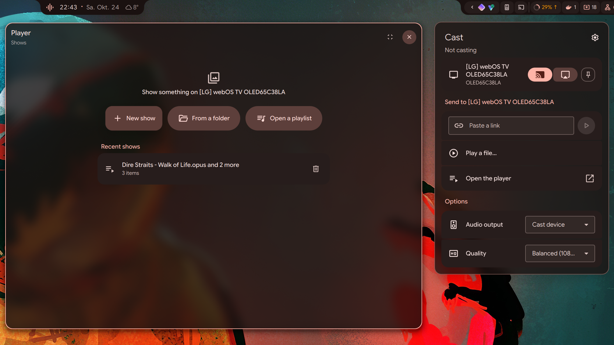
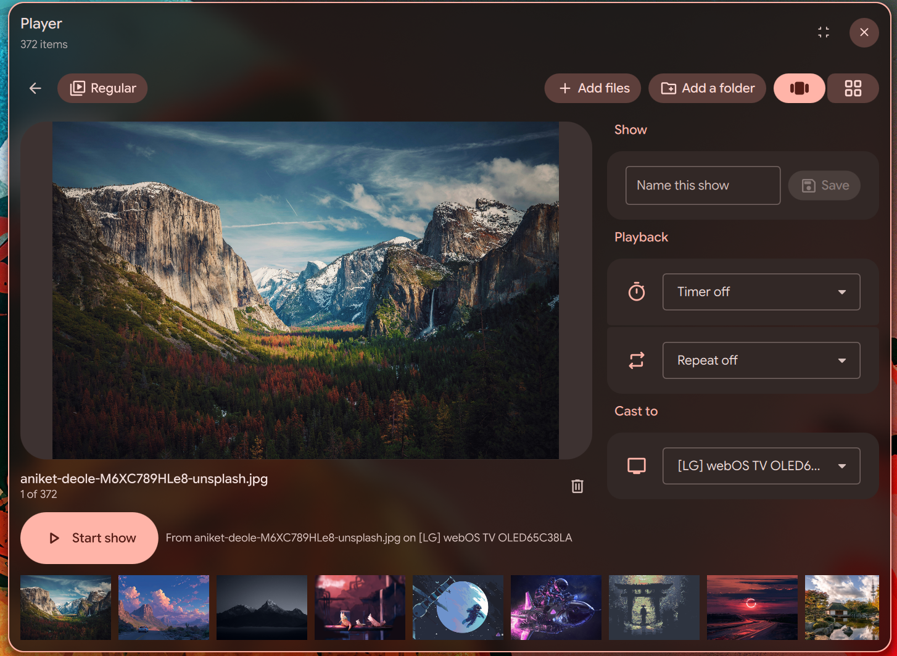
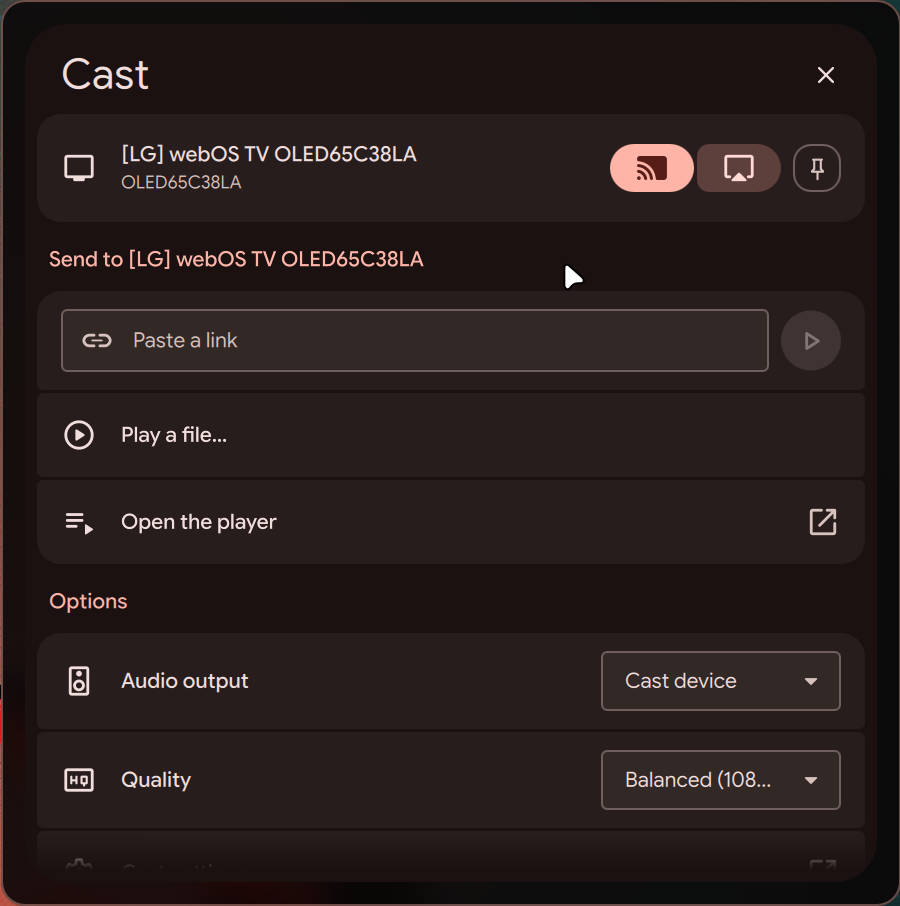
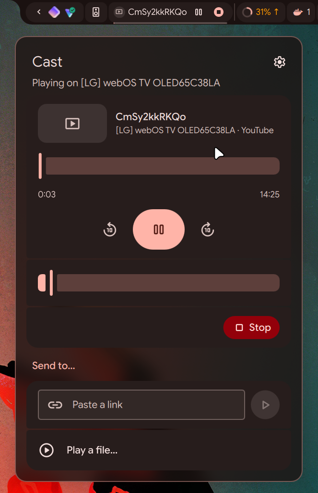
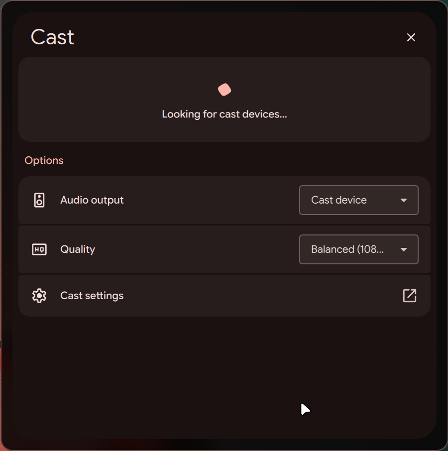

# Cast

Mirror your screen to Chromecast, Google TV and AirPlay devices, and play files, music, playlists,
slideshows and links on Chromecast devices, from the bar or the Control Center.



<details>
<summary>See it in action</summary>

The player shows what the TV shows, with the whole show in the filmstrip below.



The popout lists the devices on the network. For a TV with both Chromecast and AirPlay, the buttons
next to it pick which one mirrors, and the pin makes it the default.



While something plays, the bar pill and the popout show it with its controls.





</details>

## Features

- Screen mirroring with sound: Chromecast (720p or 1080p, 30 or 60 fps, GPU encoded) or AirPlay.
- Sound on the cast device, on this computer, or both.
- Videos, photos and music. Files the device can't play are converted on the GPU (8K, unsupported
  codecs, HEIC).
- A player for shows: mix files and folders, save them, play them on a timer or step through them.
  `.m3u` and `.pls` playlists work too.
- YouTube links open in the device's YouTube app. Direct media links play as they are.
- Controls in the bar pill, the Control Center and the media player widgets.

A device with both Chromecast and AirPlay shows up once. Mirroring uses Chromecast unless AirPlay
is picked for that device. Files, music and links always use Chromecast.

## Installation

Cast needs the plugin and `cast-helper`, which does the casting. The helper lives in its own
repository, [dux-cast](https://github.com/Conava/dux-cast), so other apps can share it.

### 1. Install cast-helper

On Arch it's in the AUR, along with the packages it needs:

```bash
yay -S cast-helper
```

Everywhere else, follow the [dux-cast installation guide](https://github.com/Conava/dux-cast#install):
a few GStreamer and Avahi packages, then a release build or a build from source. AirPlay also needs
doubletake, which is explained there too.

The plugin looks for `cast-helper` on `PATH`, then in `~/.local/share/dms/cast/bin/`. A
development build from this repo's `./dev` script, in `~/.local/share/dms/cast/dev/`, comes
first. A helper installed somewhere else can be set in Settings > Helper path. Until it's found,
the popout shows the install command for your system. It does the same when a plugin update needs
a newer helper.

### 2. Install the plugin

From Settings > Plugins, or by hand:

```bash
git clone https://github.com/Conava/dux-plugins.git ~/.local/src/dux-plugins
ln -s ~/.local/src/dux-plugins/Cast ~/.config/dms/plugins/cast
```

Enable it in Settings > Plugins and add it to a bar or the Control Center. Settings > Plugins > Cast
lists every package the helper can use, marks what's missing and shows the install command.

### 3. Open the firewall

Only needed with a firewall. The ports can be changed in Settings, which also shows the `ufw`
commands.

| Port | Used for |
|---|---|
| TCP 47830 | Playing files |
| UDP 47840-47849 | AirPlay |

## Notes

- AirPlay asks for the PIN on the device the first time. Sound stays on this computer, because
  doubletake would set the device to full volume.
- Settings above 1080p at 30 fps are marked experimental: they can lag on slow networks or devices.
- Mirroring asks for the screen through the desktop portal. The choice is remembered.
- Discovery is IPv4 only.
- Other apps can use the same helper. Their casts show in the bar and the Control Center too, with
  the app they play from.

## Network and files

The plugin itself only loads the covers of songs another app casts, from where that app says. What
cast-helper contacts and writes is listed in
[its README](https://github.com/Conava/dux-cast#network-and-files): the cast devices on the local
network, youtube.com for YouTube links, and the server of a direct link to ask for its media type.

## License

See [LICENSE](../LICENSE).
