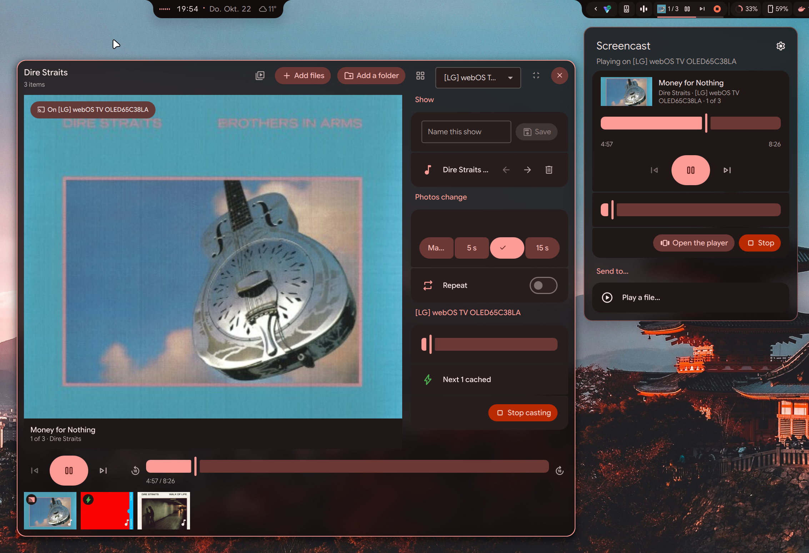

# Cast

Mirror your screen to Chromecast, Google TV and AirPlay devices, and play files, music, playlists,
slideshows and links on Chromecast devices, from the bar or the Control Center.



## Features

- Screen mirroring with sound: Chromecast (720p or 1080p, 30 or 60 fps, GPU encoded) or AirPlay.
- Sound on the cast device, on this computer, or both.
- Videos, photos and music. Files the device can't play are converted on the GPU (8K, unsupported
  codecs, HEIC).
- A player for shows: mix files and folders, save them, play them on a timer or step through them.
  `.m3u` and `.pls` playlists work too.
- YouTube links open in the device's YouTube app. Direct media links play as they are.
- Controls in the bar pill, the Control Center and the media player widgets.

A device with both Chromecast and AirPlay shows up once. Mirroring uses Chromecast unless AirPlay
is picked for that device. Files, music and links always use Chromecast.

## Installation

Cast needs the plugin, `cast-helper` (does the casting) and a few system packages. AirPlay
additionally needs doubletake.

### 1. Install the packages

Arch:

```bash
sudo pacman -S --needed avahi gstreamer gst-plugins-base gst-plugins-bad gst-plugin-pipewire gst-plugin-va \
  gst-plugins-good gst-libav libheif
```

Debian / Ubuntu:

```bash
sudo apt install avahi-daemon gstreamer1.0-plugins-base gstreamer1.0-plugins-bad gstreamer1.0-pipewire \
  gstreamer1.0-plugins-good gstreamer1.0-libav pipewire-bin libheif-examples
```

Fedora:

```bash
sudo dnf install avahi gstreamer1-plugins-base gstreamer1-plugins-bad-free pipewire-gstreamer \
  gstreamer1-plugins-good gstreamer1-plugin-libav pipewire-utils libheif-tools
```

openSUSE:

```bash
sudo zypper install avahi gstreamer-plugins-base gstreamer-plugins-bad gstreamer-plugin-pipewire \
  gstreamer-plugins-good gstreamer-plugins-libav pipewire-tools heif-examples
```

The first line of each is required, the second recommended (more formats, sound on the cast device
only, HEIC photos). Then start Avahi:

```bash
sudo systemctl enable --now avahi-daemon
```

Mirroring needs VA-API H.264 or HEVC encoding. Fedora and openSUSE ship drivers without them; get
the drivers from RPM Fusion or Packman. Settings > Plugins > Cast lists every package, marks what's
missing and shows the install command for your distribution.

### 2. Install the plugin

From Settings > Plugins, or by hand:

```bash
git clone https://github.com/Conava/dux-plugins.git ~/.local/src/dux-plugins
ln -s ~/.local/src/dux-plugins/Cast ~/.config/dms/plugins/cast
```

Enable it in Settings > Plugins and add it to a bar or the Control Center.

### 3. Install cast-helper

The plugin looks for `cast-helper` on `PATH`, then in `~/.local/share/dms/cast/bin/`. Source:
[`helpers/cast/`](../helpers/cast). Use one of these:

Download the release build (x86_64 or aarch64, built by GitHub Actions from the tagged source):

```bash
dms dl https://github.com/Conava/dux-plugins/releases/download/cast-v0.0.1/cast-helper-$(uname -m) \
  --timeout 300 -o ~/.local/share/dms/cast/bin/cast-helper \
  && chmod +x ~/.local/share/dms/cast/bin/cast-helper
```

Optionally check it against the release's checksums:

```bash
cd ~/.local/share/dms/cast/bin
dms dl https://github.com/Conava/dux-plugins/releases/download/cast-v0.0.1/SHA256SUMS \
  | sed "s/-$(uname -m)\$//" | grep "cast-helper$" | sha256sum -c
```

Or build it from source (Go 1.25 or newer, no C compiler):

```bash
cd ~/.local/src/dux-plugins/helpers/cast
CGO_ENABLED=0 go build -o ~/.local/share/dms/cast/bin/cast-helper .
```

The popout shows the download command for the installed version. Click "Check again" there once
the helper is in place.

### 4. Install doubletake (AirPlay only)

[doubletake](https://github.com/omarroth/doubletake) is an independent AirPlay sender, not part of
this project. Review it before installing. Cast is tested with 0.5.0.

Arch (AUR):

```bash
yay -S doubletake-bin
```

Other distributions, from its releases (x86_64 shown, use `doubletake-arm64` on aarch64):

```bash
dms dl https://github.com/omarroth/doubletake/releases/download/v0.5.0/doubletake \
  --timeout 300 -o ~/.local/share/dms/cast/bin/doubletake \
  && chmod +x ~/.local/share/dms/cast/bin/doubletake
```

doubletake also runs `gst-launch-1.0` and `pactl`: install `gstreamer1.0-tools` and
`pulseaudio-utils` on Debian / Ubuntu, `pulseaudio-utils` on Fedora, `gstreamer-utils` and
`pulseaudio-utils` on openSUSE, `libpulse` on Arch.

### 5. Open the firewall

Only needed with a firewall. The ports can be changed in Settings, which also shows the `ufw`
commands.

| Port | Used for |
|---|---|
| TCP 47830 | Playing files |
| UDP 47840-47849 | AirPlay |

## Notes

- AirPlay asks for the PIN on the device the first time. Sound stays on this computer, because
  doubletake would set the device to full volume.
- Settings above 1080p at 30 fps are marked experimental: they can lag on slow networks or devices.
- Mirroring asks for the screen through the desktop portal. The choice is remembered.
- Discovery is IPv4 only.

## Network and files

Apart from the cast devices on the local network, Cast only contacts youtube.com, when a YouTube
link is played. It writes to:

| Path | Contents |
|---|---|
| `~/.cache/dms/cast` | Converted files while they play, thumbnails |
| `~/.local/share/dms/cast` | The helpers, AirPlay pairings |
| `$XDG_RUNTIME_DIR/dms-cast` | doubletake's control socket during an AirPlay cast |

## License

See [LICENSE](../LICENSE).
